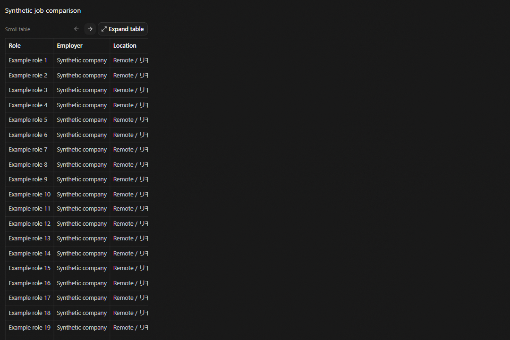
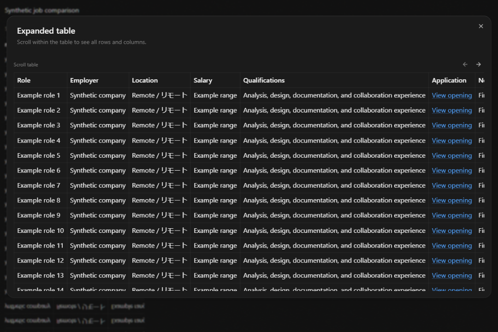

# Read wide chat tables

Wide Markdown tables scroll inside the message. The surrounding chat stays within
its pane. When a table is wider than the pane, controls appear above it:

- Use the left and right arrows to move across columns.
- Focus the table to scroll with the keyboard, or use your trackpad or scrollbar.
- Select **Expand table** to open a view that uses most of the window.
- Scroll inside the expanded view to reach every row and column. Column headings
  remain visible during vertical scrolling.
- Press Escape or select Close to return to the chat. The inline table keeps its
  scroll position, and keyboard focus returns to the expand button.

Small tables do not show the additional controls. Each table scrolls independently.
The controls update when streamed content or the chat pane's size changes.
Expanded views are bounded to 85% of the window height and the available width,
with a 96rem width cap. Arrow steps retain about 29.3% of the previous view to
preserve column context, following the silver-ratio spacing system. The controls
support English, Japanese, and bilingual labels.

This changes Markdown table presentation. It does not change saved chat content
or parse tables out of screenshots, PDF files, or plain text code blocks.

## 日本語

横長のMarkdown表は、メッセージ内で個別に横スクロールできます。
表の上の矢印を使うか、**表を拡大**を選択してください。
拡大した表では縦横にスクロールでき、縦スクロール中も列見出しを表示します。
Escapeキーまたは閉じるボタンで戻ると、元の表のスクロール位置を保持します。
英語・日本語・二言語表示と、狭いチャット画面に対応しています。

## Synthetic previews

These previews use a synthetic job comparison. No private job-search conversation
was read or copied into the test fixtures.

